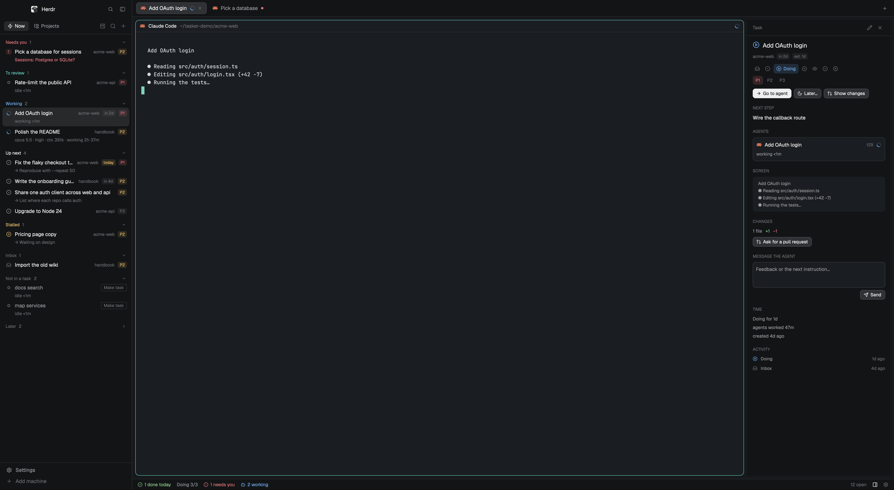
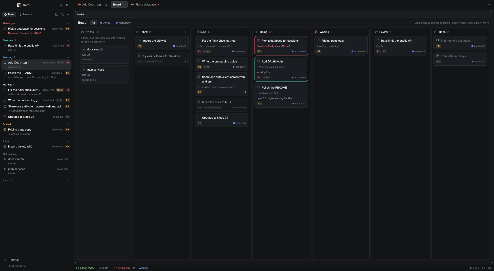

# tasker

**You plan. Your agents move the task. You close it.**
A light, local task manager for work done with coding agents, as a layout for the [Herdr app](https://herdr.dev):
projects → repositories → tasks → the agents working on them, with what needs you first.

**[Website, tutorial and examples →](https://alex-roc.github.io/herdr-tasker/)**



Herdr already shows every terminal and agent you run. tasker adds the layer above them: *what are
these agents for?* Each tab can belong to a task; a task knows its repository, priority, due date and
next step; and the list tells you what to do next: answer the agent that's waiting, review what one
finished, or start the next task.

What makes it different:

- **Tasks follow their agents, and you have the last word.** A task moves to Doing when its agent
  starts working and to Review when it stops; only you mark it Done. No pipeline to configure.
- **Real planning, not just a list of agents.** Projects and repositories, priorities, due dates in
  plain words, a limit on what's in progress, and stalled work called out.
- **Light and local.** One mod and one JSON file you (or an agent) can edit. No service, daemon,
  account or extra CLI. GitHub and Linear are optional imports.

- [What you get](#what-you-get)
- [Install](#install)
- [Use it](#use-it)
- [Keys](#keys)
- [Your data](#your-data) · [For agents](docs/agents.md)
- [What it runs on your machine](#what-it-runs-on-your-machine)
- [Troubleshooting](#troubleshooting)
- [Tutorial](https://alex-roc.github.io/herdr-tasker/tutorial.html) · [Examples](https://alex-roc.github.io/herdr-tasker/examples.html)
- [Develop](docs/development.md) · [Recipe](RECIPE.md) · [Changelog](CHANGELOG.md)

## What you get

**Now**: one list, in the order things move forward:

| Section | What's in it |
|---|---|
| **Needs you** | Tasks whose agent is blocked, with the agent's question right in the row |
| **To review** | Tasks in Review, and tasks in Doing whose agent finished |
| **Working** | Tasks with an agent at work: model · effort · context size · how long |
| **Up next** | Next, Doing and Waiting tasks by priority, then due date |
| **Stalled** | Doing or Waiting tasks that haven't moved in a few days |
| **Inbox** | Ideas and imported issues, not yet planned |
| **Later** | Tasks you put off, folded: each comes back on its day (or *someday*: when you bring it back) |

Which status when: **Next** you'll do it, **Waiting** it depends on someone else, **Inbox** not decided,
**Dropped** you won't. To put one off without changing what it is, use **Later** (right-click, `z`, or
the detail): tomorrow, next week, a day you type (`fri`, `+3d`, `12-24`) or *someday*. On its day it
comes back with a notification. Once a day, a notification also tells you what's due or late
(*Reminders* in the settings turns both off).

Agents in tabs that belong to no task show up too: in the section that fits when they need you,
finished or are working, and under **Not in a task** otherwise. **Make task** turns one into a task;
its menu also offers **Add to task…** to tie it to one you already have.

**Projects**: an outline of projects → repositories → tasks. Each repository shows its branch,
commits not pushed (↑) and uncommitted changes (•), and the terminals open there that belong to no
task. From a repository: `›_` opens a terminal there, `+` a task, and `⋯` (or right-click) starts any
installed agent there, imports GitHub or Linear issues, moves it to another project, or closes its
spaces. From a project: `›_` opens a terminal, `+` a task for the whole project, and `⋯` (or
right-click) starts an agent across all its repositories or closes them all. Work for the whole project
(its terminal, its agents, a task with a project but no repository) opens in the project's own space,
named after it, in the nearest folder holding all its repositories (`~/dev` for `~/dev/a` and
`~/dev/b`), and shows at the project's level, above its repositories. Its agent is told which
repositories are the project's (any outside that folder is added with `--add-dir`, Claude Code and
Codex); a task in one repository of a bigger project hears of the others. Terminals and agents in no task show the same line as a task:
model, effort, context and how long in their state.

**Board**: a kanban tab (`cmd-shift-b`, or the board button) with Inbox, Next, Doing (with your
limit), Waiting, Review and Done (last 7 days). Drag a card to change its status, click to open it,
right-click for its menu, filter by project. Agents in no task wait in a **No task** lane on the left:
drag one onto a column to make it a task there.



**Task detail** (right panel, when you want more: the panel button in the status bar, `cmd-i`, `i`
or *Details* in a task's menu; selecting a task never opens it, and it stays as you left it): status and priority, the next step and notes; each agent with its
model, reasoning effort, context, turn and sub-agents, and the question it's waiting on; the last
lines of its screen; the changes in its folder, its pull request and CI checks (with *Ask for a pull
request* and *Send failed checks*); a box to **message the agent**; time in state, agent time and the
history.

**Start agent** on a task opens your agent in the repository's space with the task (title, next
step, notes, issue) as its first message. **Start in a worktree** first creates the branch
`task/<name>` in `~/.herdr/worktrees/<repo>/<name>`, where Herdr's own worktree tools find it.

Tasks follow their agents: when an agent starts working the task moves to **Doing**; when it stops,
to **Review**. Only you mark a task **Done**. **Archive** puts its tabs away and can remove its
worktree (a branch with unmerged commits is kept).

**Resume agent**: tasker remembers the Claude Code or Codex conversation each task's agent was in.
After a restart, or once you closed its tab, *Resume agent* (or `r`) runs `claude --resume <id>` or
`codex resume <id>` in its folder, tied to the task again.

**Plan usage** in the status bar (off until you turn it on in the settings): `Claude 28% wk 34%`, `Codex 8% wk 12%`, amber from 70% and red
from 90%; hover for when each limit resets, click to look again.

Inspired by the task → worktree → review → ship flow of [Orca](https://github.com/stablyai/orca).

## Install

You need the Herdr app (0.1.13 or later). `git` is used for repository state and worktrees, and
`gh` (optional) for issues and pull requests.

**From the gallery**: find *tasker* at [herdr.dev/layouts](https://herdr.dev/layouts) and ask your
agent in Herdr to add it, or point it at this repository: *"add the layout at
github.com/alex-roc/herdr-tasker"*. Herdr's agents know how to install a shared layout.

**With the script**:

```sh
git clone https://github.com/alex-roc/herdr-tasker && cd herdr-tasker
./install.sh --keys    # the layout, its picture and theme, the mod, and its shortcuts
```

Then pick **tasker** in Settings → Look, or run `herdr-app do layout.switch '{"name":"tasker"}'`.
Your other layouts are untouched; switch back the same way.

- `./install.sh` alone skips the shortcuts. `--keys` adds a `layout:tasker` section to
  `keys.json` and never replaces a key you already bound there.
- Run it again to update. `./install.sh --uninstall` removes tasker and keeps your tasks.
- It copies instead of linking: Herdr only hot-reloads files saved inside its own folder.

**By hand**: copy `layouts/tasker.json` and `layouts/tasker.svg` to `~/.config/herdr-app/layouts/`,
`themes/tasker.json` to `~/.config/herdr-app/themes/`, and `mods/tasker/` to
`~/.config/herdr-app/mods/`. Check it with `herdr-app check ~/.config/herdr-app/mods/tasker`.

## Use it

1. **Add a project.** In Projects, the folder button makes one; tick the repositories that belong
   to it (any repository open in Herdr is offered), or *Add folder…* for one that isn't open. Or
   right-click a repository → Project.
2. **Add tasks.** `n`, the `+` button, `+` on a repository, or *Import GitHub issues* / *Import
   Linear issues* from a repository's menu. A due date takes `today`, `tomorrow`, `fri`, `+3d`, `2w`,
   `12-24` or `2026-12-24`.
3. **Start an agent.** `l` (or ▶ on hover, or *Start agent* in the detail) starts your agent with the
   task as its first message; `w` does it in a new worktree. The new tab is tied to the task.
4. **Already working?** An agent in no task has **Make task**, **Add to task…** in its menu, and a
   card in the board's **No task** lane to drag onto a column.
5. **Work from Now.** Answer what needs you, review what's done (*Show changes*, the PR and its
   checks are in the detail), then press `space` to mark it done.

Settings (the gear in the status bar): Now and Projects as tabs or **stacked** (both at once, one
above the other, as Herdr's spaces and agents), how many tasks can be in Doing before the status bar
warns you, after how many days a task counts as stalled, which agent *Start agent* runs, and whether
the status bar shows plan usage. Stacked, `tab` moves the keys between the two lists.

**Linear** (optional): create a personal API key (Linear → Settings → Security & access → Personal
API keys) and either export it as `LINEAR_API_KEY` in your login shell profile or save it alone in
`~/.config/herdr-app/data/tasker/linear-key`. *Import Linear issues* lists your open issues assigned
to you; their priority and due date come along. tasker only reads from Linear.

## Keys

With `./install.sh --keys` (only while the tasker layout is shown):

| Key | Does |
|---|---|
| `cmd-j` | Move the keyboard to the task list |
| `cmd-k` | Find a task |
| `cmd-shift-n` | New task |
| `cmd-shift-o` | Switch Now ⇄ Projects |
| `cmd-i` | Show or hide the task detail |
| `cmd-shift-b` | Open the board |

In the list: `j`/`k` or arrows move, `enter` goes to the task's agent, `space` marks done (again: back
to Next), `1` `2` `3` set priority, `n` new, `e` edit, `l` start agent, `w` start in a worktree, `r` resume
its agent, `z` later, `i` details, `/` find, `tab` switches view. Clicking a task shows it and brings its agent's tab (or its
terminal) to the front. Right-click a task, a repository or a project for its menu.

From a script or an agent: `herdr-app do tasker.new`, `tasker.board`, `tasker.view`, `tasker.jump`,
`tasker.settings`, `tasker.linear` (import Linear issues), and `tasker.select:<task id>` (shows that task).

## Your data

Everything lives in `~/.config/herdr-app/data/tasker/tasks.json`: plain JSON that you, or an agent,
can edit. tasker reloads it within a second of a save, checks every field, and never writes over a
file it can't read (it shows what's wrong instead). It never goes in this repository.

```jsonc
{
  "settings": { "wip": 3, "stale_days": 3, "agent": "claude", "usage": false, "reminders": true },   // agent: a key from Herdr's agent menu
  "projects": [{ "id": "p1", "name": "Acme", "color": "ansi4", "repos": ["~/dev/acme"] }],
  "tasks": [{
    "id": "t1", "title": "Add OAuth login", "project": "p1", "repo": "~/dev/acme",
    "status": "next",            // inbox | next | doing | waiting | review | done | dropped
    "priority": 1,               // 1 high, 2 normal, 3 low
    "due": "2026-11-20", "estimate": "2h", "next_step": "Wire the callback", "notes": "",
    "snooze": null,              // Later: "YYYY-MM-DD" (back that day) or "someday"
    "issue": { "source": "github", "number": 12, "url": "https://github.com/…", "body": "…" },  // Linear: "number": "ENG-12"
    "worktree": null, "branch": null,
    "tabs": ["<herdr tab id>"], "agent_ms": 0, "history": [{ "s": "next", "at": 1794000000000 }],
    "sessions": [{ "app": "claude", "id": "<session id>", "cwd": "~/dev/acme", "at": 1794000000000 }]
  }]
}
```

Only `id` and `title` are needed for a new task; everything else gets a default. A task's tabs are
also labelled on their terminals (`tasker.task=<id>`, see `hc ls`), so a task finds its agents again
even if the file loses them. Agents that should add or move tasks: see **[docs/agents.md](docs/agents.md)**.

## What it runs on your machine

The mod runs these programs, only on your machine (or the machine a space lives on):

- `git`: read-only status and diffs, without taking locks; `worktree add`, `worktree remove` and
  `branch -d` only when you ask for a worktree or archive one.
- `gh`: `issue list` and `pr view`, when you import issues or look at a task in review.
- `hc` (Herdr's core): read an agent's last screen lines, send it your message, label terminals.
- `tail`, `grep` and `lsof`: to read the model, effort and context of Claude Code
  (`~/.claude/sessions`, `~/.claude/projects`) and Codex (`~/.codex/sessions`) from their own logs.
- `open` (`xdg-open` on Linux) for issue and pull request links.
- Your `claude` CLI, for a moment every 5 minutes while the window is in front, to ask for plan
  usage (`mods/tasker/bin/claude-usage.sh`): the CLI signs in by itself, tasker reads no token or
  credential file, and no prompt is sent. Codex's limits come from its own logs. Turn it off in the
  settings.

Its only request of its own goes to `api.linear.app`, and only when you open *Import Linear issues*.
Nothing else is sent anywhere. While the window is in the background, or the detail panel is closed,
it looks less often or not at all.

## Troubleshooting

- **The list says tasks.json can't be read.** The file has a JSON error (often a hand edit): fix
  it and save; tasker picks it up. Nothing was overwritten.
- **No model or effort on an agent.** Only Claude Code and Codex write them where tasker can read
  them. They appear after the agent's first reply.
- **A launched agent isn't tied to its task.** tasker looks for the new tab for 30 seconds. Use
  **Make task** on the tab, or add its tab id to the task's `tabs`.
- **Claude's usage shows `!`.** Hover it for the reason. tasker asks your `claude` CLI (`claude -p`
  with a usage request); an old CLI, or an account without plan limits, has nothing to report.
- **Resume agent doesn't appear.** tasker learns a task's conversation while its agent runs (Claude
  Code and Codex only); a task whose agent never ran under tasker has nothing to resume.
- **Changes in a mod file don't show up.** Run `./install.sh` again: Herdr doesn't reload a mod
  folder that is a symlink. `herdr-app status` lists any error.
- **Stuck in a broken layout.** `ctrl-alt-shift-escape` always goes back to Herdr's default layout.

## License

[MIT](LICENSE). Icons are [Lucide](https://lucide.dev) (ISC, `mods/tasker/icons/LICENSE`).
