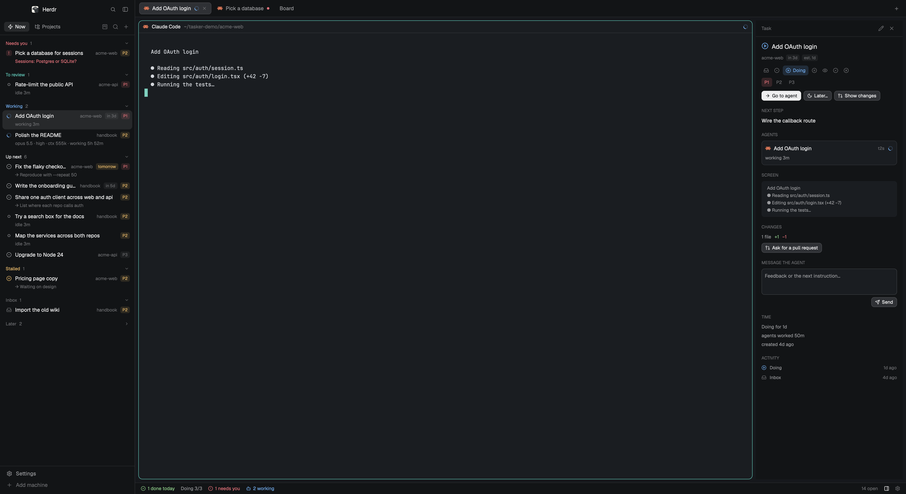

# tasker

A task manager for work done with coding agents. The left sidebar lists what needs you now, or an
outline of projects → repositories → tasks; the right panel shows one task with its agents (model,
effort, context), its changes and pull request, and a box to message the agent; a board tab shows
every task by status.

## What you see

- **Left sidebar, 330px** (`chrome` background), from Herdr's main layout: the brand row (46px,
  `workspace-chrome`), the tasker list, the footer (69px, `workspace-chrome` with `footer: true`).
  - Header (40px, border below): two pill buttons **Now** (zap icon) and **Projects** (folder-tree),
    24px high, the shown one on `selected`; then 22px icon buttons with tooltips: (Projects only)
    eye/eye-off "Show done tasks", folder-plus "New project"; (Now only) square-kanban "Board", the
    board of every project (in Projects, each project's row has its own); search "Find a task"; plus
    "New task".
  - **Now**: collapsible sections, header 11px medium in the section's color plus a count and a
    chevron: Needs you (`blocked`), To review (`done`), Working (`working`), Up next (foreground,
    first 7, then "N more" which opens Projects), Stalled (`ansi3`), Inbox (`dim`, first 5).
    Then **Not in a task** (`dim`): idle agents whose tab belongs to no task; then **Later** (`dim`,
    folded until opened): tasks put off, soonest back first, *someday* last.
    Empty: "Nothing needs you. Press n for a new task, or open Projects to see your repositories."
  - **Projects**: a project row (9px colored square, name 12px semibold, count of tasks and loose
    tabs, chevron); under it the tasks without repository, then repository rows (chevron, name,
    `⎇ branch`, `↑ahead`, `•dirty` in `ansi3`, "not open" when no space is in it, each with a
    tooltip; then `square-terminal` new terminal, `plus` new task, `ellipsis` menu), the
    repository's tasks, and its tabs in no task. Open git repositories and folders in no project go
    under "No project". While the pointer is on a project row, its count gives way to its actions:
    `square-kanban` (its board), `square-terminal` (a terminal for the whole project), `plus` (a task
    for the whole project) and `ellipsis` (its menu). Dragging a project row onto another moves it
    there (dimmed while dragged; a 2px `accent` line above or below the target shows where it lands);
    the order is `projects` in tasks.json.
  - **Task row**: 16px mark (the lead agent's state as Herdr draws it: spinner, "!" on
    `blocked`+26 alpha, 7px dot `done`, ring `idle`; else the status icon: inbox, circle-dot,
    circle-play, circle-pause, eye, circle-check, circle-x), title (semibold when its agent is done),
    repository name in Now, due chip ("2d late" on `blocked`, today/tomorrow on `ansi3`, else `dim`),
    priority chip P1 `ansi1` / P2 `ansi3` / P3 `dim`. A second 11px line: the agent's question in
    `blocked`, else "opus 5.5 · high · ctx 241k · working 4m" (or "finished 3m ago", "idle 1h"), else
    "Later · back fri" (title in `dim`) for a task put off, else "→ next step". Hover shows a play
    button on tasks without an agent. Selected row on `selected`.
  - **Loose tab row** (a tab in no task): program icon or terminal icon, its name (the tab's name,
    the agent's title, else "zsh · <folder>", never the address), a second line like a task's
    (the question, else "opus 5.5 · medium · ctx 54k · idle 1h"), and a **Make task** button
    (tooltip "Turn this tab into a task…"; the task is Doing if its agent works or waits on you,
    Review if it finished, else Next). Right-click: a popup (240×150) with Make task, Add to task…
    (the find dialog in attach mode: open tasks only, picking one ties the tab to it) and Go to agent.
- **Two lists at once** (optional): the list block sits in a stack `tasker-lists` whose other child,
  `tasker-split`, is a column of two blocks with `view: "projects"` (top) and `view: "now"` (bottom),
  weight 1 each, min 90px. A list with a `view` shows its name (icon + "Projects"/"Now") instead of
  the two pills. The settings pick the child with `layout.select`.
- **Right column `tasker-detail`, 360px, hidden until opened** (status-bar button, cmd-i, `i`,
  *Details*, or a card clicked on the board; selecting a task never opens it): header "Task" with pencil
  and ✕; title 15px with its status icon; repository, due chip, "est. 2h", issue link; a row of status
  icons where only the current one shows its name, and P1–P3; actions (Start agent / Start in a
  worktree, or Go to agent; with no agent and a remembered conversation, Resume agent first (rotate-ccw,
  tooltip "Continue its last Claude Code conversation (2h ago)"); Later… (moon) or Bring back with a
  "Later · back fri" chip; Mark done in Review; Show changes); sections in 10.5px uppercase `dim`:
  Next step, Notes, Agents (cards: program icon, title, address, state, "opus 5.5 · medium · ctx
  248k · turn 7 · working 1m", the pending question, sub-tasks and sub-agents as a tree), Screen
  (last 8 non-empty lines of the agent's terminal), Changes (branch, "N files +add −del", PR chip
  that opens the PR, checks chip, "Ask for a pull request", "Send failed checks"), Message the agent
  (textarea + Send), Time ("Doing for 2h", "agents worked 47m", "created 4d ago"), Activity
  (history, newest first).
- **Board** (a tab whose only pane is the mod with `role: "board"`, named "Board"; a project's own
  board is another tab, "Board · <project>", with `project: <id>` in its props, its tasks and agents
  only. Every board's header has the pills All + each project (the current one on `selected`); a pill
  goes to that board's tab, made when not open (tabs are found by name); an open one is focused instead of
  making another): header 44px on `canvas` with "Board", project pills (All + each project with its
  color) and a hint; six columns that share the width (min 210, max 320px) on `chrome`, radius 10,
  header 38px (status icon, name, count; Doing shows n/limit in `ansi3` when over; + on Inbox and
  Next); cards on `background`, radius 9, border `blocked` when the agent needs you, `accent` when
  selected: mark + title, next step, the question or "model · effort · working 4m", chips (P, due,
  #issue, branch) and the repository. Empty column: a 56px "Nothing here" box. Done shows the last 7
  days. Dragging dims the card and highlights the column under the pointer (`selected` + `accent`
  border); releasing there sets the status. When agents in no task exist, a **No task** lane (190–260px,
  `canvas`, bot icon, a one-line hint) comes first with a card per agent (mark, name, model · effort ·
  time, repository); dropping one on a column makes it a task with that status, releasing it on its
  own lane goes to the agent.
- **Status bar, 28px**: "✓ N done today" (`ansi2` when > 0), "Doing n/limit" (`ansi3` and "finish
  something first" when over), "! N need(s) you" (click: Now), "N working"; on the right plan usage
  "Claude 28% wk 34%" and "Codex 8% wk 12%" (`muted`, `ansi3` from 70%, `blocked` from 90%, by the
  fuller limit; tooltip with reset times; click looks again; "Claude !" with the reason on error),
  "N open", a `panel-right` button that shows or hides the detail (`foreground` when shown) and a
  settings gear. Plan usage is off until turned on.
- **Dialogs** (Herdr dialogs, `popover` background): task form 560×660, project 480×500 (repositories
  to tick, and *Add folder…* with the system's folder picker), settings 480×940, find 520×420, issues
  540×460, archive 460×230, delete 420×190, close 440×200, later 420×200; menus are popups (task
  270×410, repository 250×370, project 270×290, loose tab 240×150). Forms scroll and keep their
  buttons in a footer with a border.
- Theme: `themes/tasker.json` for dark (`#1a1d21` background, teal accent `#5fc4b5`, `working`
  `#6fa8e8`, `blocked` `#e5737b`, `done` `#5fc4b5`), Herdr's `paper` for light.

## How it behaves

- Agent states come from Herdr: working (spinner), blocked (Needs you, with the agent's question),
  done (dot; the task goes to To review), idle (ring). A task's state is its most urgent agent's,
  sub-agents included.
- When a task's agent starts working the task becomes *doing* (from inbox, next, waiting, review or
  done); when it stops after working, a *doing* task becomes *review*. Nothing becomes *done* by
  itself. A finished agent puts its task in To review only from Doing: Next, Waiting and Inbox stay.
  Agent working time adds up per task. The list copies do this bookkeeping, their state shared
  (`globalThis`) so two lists on screen record each change once.
- Clicking a task selects it and focuses its agent's pane (else a terminal of its tabs); Enter does
  the same, and opens the task form when it has neither.
  Right-click: a task's menu (details, edit, start, start in worktree, status icons, priority, Later:
  Tomorrow / Next week / Someday / Pick…, Bring back, archive, delete in `blocked`); a repository's
  menu (new terminal, "New <agent> here" for each installed agent, close repo, new task, import
  issues, its project); a project's menu (header: color, name, "2 repositories"; Board, New task…;
  "Across its repositories, in ~/dev", Terminal and each agent; Edit project…, Close project…).
- Later: `snooze` is `YYYY-MM-DD` (a day after today) or `someday`. A task put off leaves every Now section but Needs you
  and Working, and waits in Later; on its day it comes back (snooze cleared) with a notification.
  Doing, done and dropped clear it.
- Reminders (on by default): a notification for tasks back from Later, and once a day (`reminded`)
  for what's due today or late; one notification for several; clicking it runs `tasker.select:<id>`
  (or `tasker.focus`).
- A task for the whole project (a project, no repository) and a project's own terminals and agents
  run in the project's own space (named after it) in the nearest folder holding all its repositories
  (a lone repository's parent; the home folder for a project with none), with `--add-dir` for any
  repository outside it (Claude Code and Codex);
  the first message names every repository of the project. Their terminals are labelled
  `tasker.project=<id>` and their tabs show at the project's level, above its repositories, never
  under a repository or No project. Close project closes that space too. A task in one repository of a bigger project hears of the others.
- Close repo / Close project: one confirmation ("Closes its 2 spaces … and 1 agent"), then
  `space.close {confirmed: true}` for each space open in those repositories.
- Delete and archive ask first. Delete hides the task (`deleted: true`); archive marks it done,
  settles its tabs and can `git worktree remove` + `git branch -d`.
- Start agent: `tab.new` in the repository's space named after the task with the task as its first
  message (or `space.new`); the new tab (one named like the task first, never one already a task's)
  is tied to the task and its terminals labelled `tasker.task=<id>`. In a worktree: `git worktree add
  -b task/<slug> ~/.herdr/worktrees/<repo>/<slug>` first (`<slug>-<id end>` if another task has it).
- Task form: title (required: Save is dimmed without it), project, repository (projects' repos and
  open git repositories), status, priority (P1 High, P2 Normal, P3 Low), due (today, tomorrow, fri,
  +3d, 2w, 12-24, 2026-12-24, with "in 3d · 2026-11-10" beside the label, red border when not
  understood), estimate, next step, notes. Enter saves once.
- Settings: Now and Projects (Tabs / Stacked, when the layout has `tasker-lists`), steppers for the
  Doing limit (1–20) and stalled days (1–60), Reminders On/Off, Plan usage On/Off (off by default),
  and the installed agents as pills (the chosen one stays even if not installed).
- Resume: while a local Claude Code or Codex agent runs, its session id and folder are kept on the
  task (`sessions`, newest 5). Resume runs the agent's `run` + `--resume <id>` (Codex: `resume <id>`)
  in that folder, with no first message, through the same launch-and-tie path as Start agent.
- Light tasks (setting `track`, on by default): the bookkeeping adopts every tab with an agent and no
  task as a task with `auto: true` (status from its agent: Doing, Review, else Next; a tab opened for a
  project goes to that project with no repository). While `auto`, its title follows the agent's own
  title, and a minute after its tab is gone from every space (not counting away machines or no spaces
  at all) it's removed. Any change the person makes (form, menu, keys, detail, board, Later) drops
  `auto` (`kept()`). A tab whose task was deleted isn't adopted again by itself.
- Agents after a restart (`lib/revive.js`, setting `revive`, on by default): for each local terminal
  with a Claude Code or Codex agent in front and a transcript, `data/tasker/terminals.json` keeps
  `{pid, tab, app, id, cwd, at}` by address. A terminal at that address, in that tab, with another
  pid and no agent in front (Herdr recovered it as a shell) gets `cd '<cwd>' && <resume>` through
  `env -u HC_TERMINAL_ID hc send`, once, and a notification. The same shell alone in front for 10 s
  (quit by hand) forgets it; another tab at the address forgets it; 14 days old, forgotten.
- A pane whose program isn't a shell and is an agent by Herdr's table, its report or its key
  (claude, codex) counts as an agent even when it reports no state (`claude attach`). Its state comes
  from its title as the core has it (`hc get`: Herdr strips the mark for mods), every 3 s with the
  window in front, a change redrawing every copy: ◐◓◑◒ or braille first is working, ✳ idle, else
  `unknown` ("running 4m"). Its session comes from `~/.claude/projects/<folder>/<attach id>*.jsonl`.
- Import issues: GitHub (`gh issue list`) or Linear (GraphQL `viewer.assignedIssues`, not completed or
  canceled, with a personal API key from `$LINEAR_API_KEY` or `data/tasker/linear-key`; Linear
  priority 1–2 → P1, 3 → P2, 4 → P3; due date kept). Issues already imported (same URL) are hidden.
  Linear issues show as "ENG-12", GitHub ones as "#12".
- Keys in the list: j/k, arrows, enter, space, 1–3, n, e, l, w, r, z (later), i (details), /, tab
  (with two lists: to the other one). Layout keys: cmd-j, cmd-k,
  cmd-shift-n, cmd-shift-o, cmd-i, cmd-shift-b. Mod commands: `new`, `jump`, `board`, `view`,
  `focus`, `settings`, `linear`, `select:<id>` (selects it and opens the detail: scripts and
notifications ask for it). With two lists on screen, Now acts on them and sets agent.next/prev.

## Built from

- Layout: Herdr's `main` with `sidebar-lists` replaced by the stack `tasker-lists` (a block `{mod:
  "tasker", props: {role: "sidebar"}}`, and the `tasker-split` column of two lists), a hidden column `tasker-detail` (`role: "detail"`) appended to `work-body`, and the
  status block given `role: "status"`; root `"preview": "layouts/tasker.svg"`. Kept:
  `workspace-chrome`, `tabs`, `pane` (header), `files`, `changes`.
- One mod, `tasker`, roles by props; dialogs are the same mod as overlays with `{dialog: "task" |
  "project" | "menu" | "repo" | "project-menu" | "jump" | "issues" | "archive" | "confirm-delete" |
  "confirm-close" | "later" | "settings"}`,
  opened through one function that holds their sizes.
- Data in `data/tasker/tasks.json`: `readTextFile`, every task and project cleaned on read,
  `writeTextFile` compare-and-swap with retries, never over a file that doesn't parse, `watchFolder`
  to reload. Cross-copy state: `shared("tasker.selected")`, `shared("tasker.view")`,
  `shared("tasker.pending")` (launches waiting for their tab); caches on `globalThis` (agent info,
  repository state, since-when) so every copy looks once.
- `spaces()`, `panes()`, `agents()`, `terminals()` joined per render; `setAgentOrder` follows the
  list. Since when: `status_ms`, else the tab's `working_since` / `changed_at`, else tasker's stamp.
- `layout()` tells whether `tasker-detail` is on screen (a stack shows only its `active` child): the
  detail reads `hc read`, `git diff` and `gh pr view` only then, every 15 s with the window in front
  (PR every 60 s), and redraws only when what it read changed; it skips `hc read` while the agent's
  terminal has the focus. Agent info, repository state and plan usage redraw only on news too: every
  redraw of a mod redraws the whole window.
- Model, effort and context: Claude Code `~/.claude/sessions/<pid>.json` → transcript, searched
  with `tail -c 4MB | LC_ALL=C grep -aoE` for the last `"model"`, `"effort"` and usage counts (16 MB
  if not found); Codex rollout via `lsof -p <pid>` → `turn_context` and `token_count`; on another
  machine, that machine's `$HOME`.
- Plan usage (`lib/usage.js`, status bar copy only, every 5 min with the window active): Claude via
  `mods/tasker/bin/claude-usage.sh`, which starts `claude -p --safe-mode --no-session-persistence
  --input-format stream-json --output-format stream-json` and writes one control request
  `{"type":"control_request","request":{"subtype":"get_usage"}}`, reading `rate_limits.five_hour`
  and `seven_day` (`utilization`, `resets_at`) from the `control_response`; Codex from the last
  `rate_limits` (`primary`/`secondary`: `used_percent`, `window_minutes`, `resets_at`) in its 3 newest
  rollout logs. A window whose reset passed counts as 0%.
- Programs: git, gh, hc, tail, grep, lsof, open/xdg-open, claude (usage only); fetch to Linear.
- Icons: Lucide SVGs in `mods/tasker/icons` (status, header, repository and menu icons, settings,
  trash-2, circle and circle-check for checkboxes).

## Watch out

- Herdr does not hot-reload a mod folder that is a symlink: install by copying.
- `child(null)` throws; a helper that may return nothing (the due chip) must be guarded.
- Claude Code transcripts carry multi-megabyte lines (pasted images): parsing a fixed tail as JSON
  lines finds nothing. Grep the fields; keep it to a few MB with `LC_ALL=C`.
- `terminals()` doesn't always carry `status_ms`; every copy stamping its own "since" makes the
  views disagree: share it.
- `hc read` output carries "[hc] …" notes; drop them. Shell titles are often the terminal address.
- The tabs mod re-hides the `panel` column per space, so the detail lives in its own column.
- Herdr already notifies blocked and done agents; tasker adds no toasts for them.
- Closing an overlay drops that copy and the work it spawned: a dialog writes first, then closes.
- Key commands reach every shown copy: with two lists, only Now acts.
- A store write that fails redraws once for the message, not on every retry (a render that retries
  it would loop).
- Reminders come from the list copies: a layout without a tasker list sends none.
- `herdr-app shot` returns the last frame: with the window in the background it can be stale.
- The theme file is part of the layout: copy `themes/tasker.json` too.

## Done when

- `herdr-app check ~/.config/herdr-app/mods/tasker` passes, and with props for each role and dialog.
- Switching to tasker shows Now with sections; a Claude Code agent on a task shows its model and effort.
- Editing tasks.json by hand updates the list within a second; a JSON error shows a message and
  the file is left as it was; a task with a due of "next week" still draws.
- Start agent on a task with a repository opens a tab there, the task turns doing, and the tab is
  listed under the task; when the agent stops, the task is in To review.
- The board's six columns fit a 1500px-wide window with the detail open.
